# 나만의 퀴즈 게임 (파이썬·Git 코드 읽기 퀴즈)

터미널에서 동작하는 파이썬 콘솔 퀴즈 게임입니다. (코디세이 입학연수 미션 2)
퀴즈를 풀고, 추가하고, 목록과 최고 점수를 확인할 수 있으며, 프로그램을 종료해도 데이터가 `state.json`에 남습니다.

## 목차

1. [프로젝트 개요](#1-프로젝트-개요)
2. [퀴즈 주제 선정 이유](#2-퀴즈-주제-선정-이유)
3. [개발 환경](#3-개발-환경)
4. [실행 방법](#4-실행-방법)
5. [기능 목록](#5-기능-목록)
6. [파일 구조](#6-파일-구조)
7. [데이터 파일 설명 (state.json)](#7-데이터-파일-설명-statejson)
8. [입력·예외 처리 기준](#8-입력예외-처리-기준)
9. [main.py 전체 코드](#9-mainpy-전체-코드)
10. [코드로 배우는 Python (과제 목표 정리)](#10-코드로-배우는-python-과제-목표-정리)
11. [Git 정리](#11-git-정리)
12. [실행 화면](#12-실행-화면)
13. [제출물 체크리스트](#13-제출물-체크리스트)
14. [성능 분석 (퀴즈 1000개 이상)](#14-성능-분석-퀴즈-1000개-이상)
15. [백업과 복구 절차](#15-백업과-복구-절차)
16. [요구 변경 시 수정 위치](#16-요구-변경-시-수정-위치)

---

## 1. 프로젝트 개요

- **목표:** 입력 → 처리 → 출력 흐름을 가진 파이썬 콘솔 프로그램을 처음부터 끝까지 직접 만들고, 그 과정을 Git으로 기록한다.
- **구성:** `Quiz`(퀴즈 1개)와 `QuizGame`(게임 전체) 두 개의 클래스로 역할을 나눴다.
- **데이터 영속성:** 퀴즈 목록과 최고 점수를 JSON 파일(`state.json`)에 저장해서, 프로그램을 껐다 켜도 유지된다.
- **Git 기록:** 기능 단위로 커밋하고, 브랜치를 나눠 작업한 뒤 병합하며, GitHub에 저장소를 공개했다.
- **안전한 저장:** 저장 전에 백업(`state.json.bak`)을 만들고, 파일이 손상되면 백업으로 자동 복구한다. ([15장](#15-백업과-복구-절차))
- **성능 확인:** 퀴즈가 1,000개 이상일 때의 시간·메모리를 `benchmark.py`로 측정했다. ([14장](#14-성능-분석-퀴즈-1000개-이상))
- **외부 라이브러리 없이** 파이썬 표준 라이브러리(`json`, `os`, `shutil`)만 사용한다.

## 2. 퀴즈 주제 선정 이유

**주제: 파이썬·Git 코드 읽기**

초보 개발자인 내가 미션을 먼저 완료한 뒤, **내가 만든 코드와 미션에서 배운 용어로 복습**하기 위해 이 주제를 골랐다. 퀴즈를 만들고 푸는 과정이 곧 시험 대비가 된다.

| # | 문제 | 정답 | 확인하는 개념 |
|---|---|---|---|
| 1 | `x = "3"` 일 때 `type(x)`의 결과는? | 2. `str` | 입력은 항상 문자열 |
| 2 | `fruits = ["사과", "배", "귤", "감"]` 일 때 `fruits[2]`는? | 3. 귤 | 리스트 번호는 0부터 |
| 3 | 파이썬에서 "같은지 비교"하는 기호는? | 1. `==` | `=`(담기)와 `==`(비교)의 차이 |
| 4 | 조건이 끝날 때까지 몇 번 돌지 모를 때 쓰는 반복문은? | 4. `while` | `for`와 `while`의 차이 |
| 5 | 원격 저장소를 처음 통째로 내려받는 Git 명령은? | 3. `clone` | `clone`과 `pull`의 차이 |

## 3. 개발 환경

| 항목 | 내용 |
|---|---|
| OS | Ubuntu on WSL (버전: `Ubuntu 26.04.1 LTS`) |
| 에디터 | VS Code (WSL 연결) |
| Python | 필요 버전: 3.10 이상 (현재 3.14.4) |
| Git | 2.53.0 |
| 외부 라이브러리 | 없음 (`json`, `os`, `shutil` 표준 라이브러리만 사용) |

환경 확인 명령:

```bash
python3 --version
git --version
git config --list
```

## 4. 실행 방법

Python **3.10 이상**과 Git이 필요하다. 외부 라이브러리는 설치하지 않아도 된다.

**처음 받을 때 (clone)**

```bash
git clone https://github.com/modugachi/quiz-game.git
cd quiz-game
python3 main.py
```

**이미 받은 뒤 (최신 변경 가져오기)**

```bash
cd quiz-game
git pull
python3 main.py
```

- 첫 실행에서는 `state.json`이 없어서 기본 퀴즈 5개로 시작하고, 첫 실행 후 종료하면 `state.json`이 만들어진다.
- 메뉴에서 번호(1~5)를 입력해 기능을 선택한다.
- `python3` 명령이 있는 환경이면 `python3 main.py`로도 실행할 수 있다.
- **실행이 안 될 때 진단:** `python3 --version`으로 3.10 이상인지 확인하고, `ls`로 `main.py`가 있는 폴더인지 확인한다.
- **정상 실행 예시 (첫 실행):**

```text
🆕 저장된 데이터가 없어 기본 퀴즈로 시작합니다.
========================================
      🎯 나만의 퀴즈 게임 🎯
========================================
1. 퀴즈 풀기
2. 퀴즈 추가
3. 퀴즈 목록
4. 점수 확인
5. 종료
========================================
선택: 
```

## 5. 기능 목록

- [x] 메뉴 출력과 종료
- [x] 퀴즈 풀기 (전체 출제, 정답/오답 표시, 결과 점수)
- [x] 퀴즈 추가 (문제, 선택지 4개, 정답 번호)
- [x] 퀴즈 목록
- [x] 점수 확인 (최고 점수)
- [x] 잘못된 입력 처리 (공백, 문자, 범위 밖, 빈 입력)
- [x] 종료 후에도 데이터 유지 (`state.json`)
- [x] 파일이 없거나 손상돼도 실행 가능 (기본 데이터로 복구)

## 6. 파일 구조

```
quiz-game/
├── main.py              # 프로그램 전체 (실행 파일)
├── benchmark.py         # 퀴즈 1000개 이상 성능 측정 (14장)
├── state.json           # 퀴즈 목록과 최고 점수 (실행하면 생성, Git에는 올리지 않음)
├── state.json.bak       # 직전 정상 데이터의 백업 (자동 생성, Git에는 올리지 않음)
├── README.md            # 이 문서
├── .gitignore           # Git이 추적하지 않을 파일 목록
└── docs/
    ├── clone-practice.md    # clone/pull 실습 기록
    └── screenshots/         # 실행 화면 캡처
```

**main.py 안의 구성**

| 이름 | 종류 | 역할 |
|---|---|---|
| `Quiz` | 클래스 | 퀴즈 1개(문제, 선택지 4개, 정답)를 표현. `show`, `is_correct`, `to_dict`, `from_dict` |
| `QuizGame` | 클래스 | 게임 전체를 관리. 메뉴(`show_menu`, `run`), 풀기(`play_quiz`), 추가(`add_quiz`), 목록(`show_quiz_list`), 점수(`show_score`, `update_best_score`), 저장·복구(`save`, `load`, `recover`) |
| `create_default_quizzes()` | 함수 | 기본 퀴즈 5개를 만들어 리스트로 돌려줌 |
| `get_number()` | 함수 | 범위 안의 정수를 올바르게 입력받을 때까지 묻는 공통 입력 함수 |
| `get_text()` | 함수 | 빈 글자가 아닌 입력을 받을 때까지 묻는 함수 |
| `main()` | 함수 | `QuizGame`을 만들어 실행 |

**역할을 나눈 이유:** 입력 검증(`get_number`, `get_text`), 게임 진행(`QuizGame`의 메뉴·풀기·추가), 데이터 입출력(`save`, `load`)을 서로 다른 곳에 두면, 한 부분을 바꿔도 다른 부분이 영향을 덜 받는다. 어디를 고치면 되는지는 [16장](#16-요구-변경-시-수정-위치)에 정리했다.

## 7. 데이터 파일 설명 (state.json)

| 항목 | 내용 |
|---|---|
| 경로 | 프로젝트 루트의 `state.json` (`main.py`와 같은 폴더) |
| 역할 | 퀴즈 목록과 최고 점수를 저장해서 프로그램을 종료해도 유지 |
| 인코딩 | UTF-8 (`ensure_ascii=False`라서 한글이 그대로 저장됨) |
| 저장 시점 | 퀴즈 추가 직후, 최고 점수 갱신 직후, 프로그램 종료 직전 |
| 불러오는 시점 | 프로그램 시작 시 |
| 저장 순서 | 퀴즈 추가 → 임시 파일(`.tmp`)에 쓰기 → 기존 정상 파일을 `.bak`으로 백업 → 임시 파일을 `state.json`으로 교체 |
| 백업 파일 | `state.json.bak` (직전 정상 데이터), 손상된 파일은 `state.json.corrupt`로 보관 |

**필드 구조**

| 필드 | 자료형 | 설명 |
|---|---|---|
| `quizzes` | list | 퀴즈 목록 |
| `quizzes[].question` | str | 문제 |
| `quizzes[].choices` | list(str) | 선택지 4개 |
| `quizzes[].answer` | int | 정답 번호 (1~4) |
| `best_score` | int 또는 null | 최고 점수(0~100). 아직 풀지 않았으면 `null` |

**예시**

```json
{
    "quizzes": [
        {
            "question": "x = \"3\" 일 때 type(x)의 결과는?",
            "choices": ["int", "str", "bool", "list"],
            "answer": 2
        }
    ],
    "best_score": 80
}
```

**`state.json`, `state.json.bak`, `state.json.corrupt`, `state.json.tmp`를 Git에 올리지 않는 이유:** 실행할 때마다 바뀌는 데이터라서 커밋 이력이 지저분해지기 때문이다. 대신 이 문서에 구조를 적어 두었고, 처음 실행하면 기본 퀴즈로 자동 생성된다. `.gitignore`에는 `state.json*` 한 줄로 모두 제외했다.

## 8. 입력·예외 처리 기준

| 상황 | 처리 방식 | 담당 코드 |
|---|---|---|
| 앞뒤 공백 (`" 1 "`) | `.strip()`으로 제거 후 처리 | `get_number`, `get_text` |
| 빈 입력 (그냥 Enter) | 안내 문구 출력 후 다시 입력받음 | `get_number`, `get_text` |
| 숫자가 아닌 입력 (`abc`) | `ValueError`를 잡아 안내 후 다시 입력받음 | `get_number` |
| 범위 밖 숫자 (`9`, `0`) | 안내 문구 출력 후 다시 입력받음 | `get_number` |
| `Ctrl+C` (`KeyboardInterrupt`) | 안내 문구 출력 후 저장하고 안전 종료 (저장 확인: `python3 -m json.tool state.json`) | `QuizGame.run` |
| 입력 스트림 종료 (`Ctrl+D`, `EOFError`) | 안내 문구 출력 후 저장하고 안전 종료 | `QuizGame.run` |
| `state.json`이 없음 | 기본 퀴즈 5개로 시작 | `QuizGame.load` |
| `state.json`이 손상됨 (JSON 문법 오류, 퀴즈 형식 오류, 최고 점수가 정수가 아니거나 0~100 범위 밖) | 손상 파일을 `state.json.corrupt`로 보관하고 **백업(`.bak`)으로 복구**, 백업도 없거나 손상이면 기본 퀴즈로 복구 후 다시 저장 | `QuizGame.load`, `QuizGame.recover`, `Quiz.from_dict` |
| 저장 중 오류 (권한·디스크 공간 부족) | 안내 문구 출력 후 계속 실행. 종료 시 한 번 더 저장을 시도함 ([15-4](#15-4-저장이-실패할-때)) | `QuizGame.save` |
| 퀴즈가 하나도 없음 | 안내 문구 출력 후 메뉴로 복귀 | `QuizGame.play_quiz`, `QuizGame.show_quiz_list` |
| 아직 퀴즈를 풀지 않음 | 안내 문구 출력 후 메뉴로 복귀 | `QuizGame.show_score` |

## 9. main.py 전체 코드

```python
import json
import os
import shutil

# 데이터 파일은 main.py 가 있는 폴더(프로젝트 루트)의 state.json 에 저장한다.
BASE_DIR = os.path.dirname(os.path.abspath(__file__))
STATE_FILE = os.path.join(BASE_DIR, "state.json")
BACKUP_FILE = STATE_FILE + ".bak"      # 직전 정상 데이터의 백업
CORRUPT_FILE = STATE_FILE + ".corrupt"  # 손상된 파일을 원인 분석용으로 보관
TMP_FILE = STATE_FILE + ".tmp"          # 저장 도중에만 잠깐 쓰는 임시 파일

# 저장 파일을 읽다가 발생할 수 있는 오류 모음 (파일 문제, JSON 문법, 형식 오류)
LOAD_ERRORS = (OSError, json.JSONDecodeError, KeyError, TypeError, ValueError,
               AttributeError)


class Quiz:
    """퀴즈 1개를 표현하는 클래스 (문제, 선택지 4개, 정답 번호 1~4)."""

    def __init__(self, question, choices, answer):
        self.question = question
        self.choices = choices
        self.answer = answer  # 1~4 중 하나의 번호

    def show(self):
        """문제와 선택지를 화면에 출력한다."""
        print(self.question)
        print()
        for number, choice in enumerate(self.choices, start=1):
            print(f"{number}. {choice}")

    def is_correct(self, user_answer):
        """사용자가 입력한 번호가 정답이면 True, 아니면 False."""
        return user_answer == self.answer

    def to_dict(self):
        """JSON 으로 저장하기 위해 딕셔너리로 바꾼다."""
        return {
            "question": self.question,
            "choices": self.choices,
            "answer": self.answer,
        }

    @classmethod
    def from_dict(cls, data):
        """저장된 딕셔너리를 Quiz 객체로 되돌린다. 형식이 틀리면 ValueError."""
        question = data["question"]
        choices = data["choices"]
        answer = data["answer"]
        if not isinstance(question, str) or not question.strip():
            raise ValueError("question 형식 오류")
        if not isinstance(choices, list) or len(choices) != 4:
            raise ValueError("choices 는 4개여야 합니다")
        if type(answer) is not int or not 1 <= answer <= 4:  # bool(True) 제외
            raise ValueError("answer 는 1~4 여야 합니다")
        return cls(question, choices, answer)


def create_default_quizzes():
    """기본 퀴즈 5개를 만들어 리스트로 돌려준다."""
    return [
        Quiz('x = "3" 일 때 type(x)의 결과는?',
             ["int", "str", "bool", "list"], 2),
        Quiz('fruits = ["사과", "배", "귤", "감"] 일 때 fruits[2]는?',
             ["배", "사과", "귤", "감"], 3),
        Quiz("파이썬에서 '같은지 비교'하는 기호는?",
             ["==", "=", "!=", "=>"], 1),
        Quiz("조건이 끝날 때까지 몇 번 돌지 모를 때 쓰는 반복문은?",
             ["for", "if", "def", "while"], 4),
        Quiz("원격 저장소를 처음 통째로 내려받는 Git 명령은?",
             ["push", "pull", "clone", "checkout"], 3),
    ]


def get_number(prompt, min_value, max_value):
    """min_value~max_value 사이의 정수를 올바르게 입력받을 때까지 묻는다."""
    while True:
        text = input(prompt).strip()

        if text == "":
            print("⚠️ 입력이 비어 있습니다. 숫자를 입력하세요.")
            continue

        try:
            number = int(text)
        except ValueError:
            print(f"⚠️ 잘못된 입력입니다. {min_value}-{max_value} 사이의 숫자를 입력하세요.")
            continue

        if number < min_value or number > max_value:
            print(f"⚠️ 잘못된 입력입니다. {min_value}-{max_value} 사이의 숫자를 입력하세요.")
            continue

        return number


def get_text(prompt):
    """빈 문자열이 아닌 글자를 입력받을 때까지 묻는다."""
    while True:
        text = input(prompt).strip()
        if text:
            return text
        print("⚠️ 입력이 비어 있습니다. 내용을 입력하세요.")


class QuizGame:
    """게임 전체(메뉴, 풀기, 추가, 목록, 점수)를 관리하는 클래스."""

    def __init__(self):
        self.quizzes = create_default_quizzes()  # 퀴즈 목록
        self.best_score = None  # 최고 점수 (아직 풀지 않았으면 None)

    def save(self):
        """퀴즈 목록과 최고 점수를 state.json 에 안전하게 저장한다.

        1) 임시 파일(state.json.tmp)에 먼저 쓴다.
        2) 기존 state.json 이 정상이면 state.json.bak 으로 백업한다.
        3) 임시 파일을 state.json 으로 교체한다. (저장 도중 꺼져도 원본이 깨지지 않는다)
        """
        data = {
            "quizzes": [quiz.to_dict() for quiz in self.quizzes],
            "best_score": self.best_score,
        }
        try:
            with open(TMP_FILE, "w", encoding="utf-8") as file:
                json.dump(data, file, ensure_ascii=False, indent=4)
            self.backup_current_file()
            os.replace(TMP_FILE, STATE_FILE)
        except OSError:
            print("⚠️ 저장 중 오류가 발생했습니다. 파일 권한과 디스크 공간을 확인하세요.")

    def backup_current_file(self):
        """현재 state.json 이 정상일 때만 state.json.bak 으로 복사해 둔다."""
        if not os.path.exists(STATE_FILE):
            return
        try:
            self.read_state(STATE_FILE)  # 손상된 파일이 정상 백업을 덮어쓰지 않게 검사
            shutil.copy2(STATE_FILE, BACKUP_FILE)
        except LOAD_ERRORS:
            pass

    def read_state(self, path):
        """path 의 JSON 을 읽어 (퀴즈 목록, 최고 점수)를 돌려준다. 형식이 틀리면 예외."""
        with open(path, "r", encoding="utf-8") as file:
            data = json.load(file)
        quizzes = [Quiz.from_dict(item) for item in data["quizzes"]]
        best_score = data.get("best_score")
        # 최고 점수는 None 이거나 0~100 사이의 정수여야 한다.
        if best_score is not None and (type(best_score) is not int
                                       or not 0 <= best_score <= 100):
            raise ValueError("best_score 형식 오류")
        return quizzes, best_score

    def load(self):
        """state.json 을 읽어 온다. 파일이 없거나 손상돼도 실행 가능해야 한다."""
        if not os.path.exists(STATE_FILE):
            return "🆕 저장된 데이터가 없어 기본 퀴즈로 시작합니다."

        try:
            self.quizzes, self.best_score = self.read_state(STATE_FILE)
        except LOAD_ERRORS:
            return self.recover()

        score_text = "없음" if self.best_score is None else f"{self.best_score}점"
        return f"📂 저장된 데이터를 불러왔습니다. (퀴즈 {len(self.quizzes)}개, 최고점수 {score_text})"

    def recover(self):
        """손상된 state.json 을 처리한다: 백업으로 복구, 안 되면 기본 퀴즈로 초기화."""
        # 1) 손상된 파일은 지우지 않고 .corrupt 로 옮겨 둔다. (원인 분석용)
        try:
            os.replace(STATE_FILE, CORRUPT_FILE)
        except OSError:
            pass

        # 2) 백업이 정상이면 백업으로 복구한다.
        if os.path.exists(BACKUP_FILE):
            try:
                self.quizzes, self.best_score = self.read_state(BACKUP_FILE)
                self.save()
                return "⚠️ 저장 파일이 손상되어 백업(state.json.bak)으로 복구했습니다."
            except LOAD_ERRORS:
                pass

        # 3) 백업도 없거나 손상됐으면 기본 퀴즈로 초기화한다.
        self.quizzes = create_default_quizzes()
        self.best_score = None
        self.save()
        return "⚠️ 저장 파일이 손상되어 기본 퀴즈로 복구했습니다."

    def show_menu(self):
        """메뉴를 화면에 출력한다."""
        print("=" * 40)
        print("      🎯 나만의 퀴즈 게임 🎯")
        print("=" * 40)
        print("1. 퀴즈 풀기")
        print("2. 퀴즈 추가")
        print("3. 퀴즈 목록")
        print("4. 점수 확인")
        print("5. 종료")
        print("=" * 40)

    def play_quiz(self):
        """등록된 퀴즈를 모두 출제하고, 결과에 따라 최고 점수를 갱신한다."""
        if not self.quizzes:
            print("\n⚠️ 등록된 퀴즈가 없습니다. 먼저 퀴즈를 추가하세요.\n")
            return

        total = len(self.quizzes)
        correct_count = 0
        print(f"\n📝 퀴즈를 시작합니다! (총 {total}문제)\n")

        for number, quiz in enumerate(self.quizzes, start=1):
            print("-" * 40)
            print(f"[문제 {number}]")
            quiz.show()
            print()
            user_answer = get_number("정답 입력: ", 1, 4)
            if quiz.is_correct(user_answer):
                correct_count += 1
                print("✅ 정답입니다!\n")
            else:
                print(f"❌ 오답입니다. 정답은 {quiz.answer}번입니다.\n")

        score = round(correct_count / total * 100)
        print("=" * 40)
        print(f"🏆 결과: {total}문제 중 {correct_count}문제 정답! ({score}점)")
        print("=" * 40 + "\n")
        self.update_best_score(score)

    def update_best_score(self, score):
        """새 점수가 최고 점수보다 높으면 갱신하고 저장한다."""
        if self.best_score is None or score > self.best_score:
            self.best_score = score
            print("🎉 새로운 최고 점수입니다!\n")
            self.save()

    def add_quiz(self):
        """문제, 선택지 4개, 정답 번호를 입력받아 퀴즈 목록에 추가하고 저장한다."""
        print("\n📌 새로운 퀴즈를 추가합니다.\n")
        question = get_text("문제를 입력하세요: ")

        choices = []
        for number in range(1, 5):
            choices.append(get_text(f"선택지 {number}: "))

        answer = get_number("정답 번호 (1-4): ", 1, 4)

        self.quizzes.append(Quiz(question, choices, answer))
        self.save()
        print("\n✅ 퀴즈가 추가되었습니다!\n")

    def show_quiz_list(self):
        """등록된 퀴즈의 번호와 문제를 보여준다."""
        if not self.quizzes:
            print("\n⚠️ 등록된 퀴즈가 없습니다.\n")
            return

        print(f"\n📋 등록된 퀴즈 목록 (총 {len(self.quizzes)}개)\n")
        print("-" * 40)
        for number, quiz in enumerate(self.quizzes, start=1):
            print(f"[{number}] {quiz.question}")
        print("-" * 40 + "\n")

    def show_score(self):
        """최고 점수를 보여준다."""
        if self.best_score is None:
            print("\n⚠️ 아직 퀴즈를 풀지 않았습니다. 먼저 퀴즈를 풀어보세요.\n")
        else:
            print(f"\n🏆 최고 점수: {self.best_score}점\n")

    def run(self):
        """저장된 데이터를 불러온 뒤, 메뉴를 반복하며 기능을 실행한다."""
        print(self.load())

        try:
            while True:
                self.show_menu()
                choice = get_number("선택: ", 1, 5)

                if choice == 1:
                    self.play_quiz()
                elif choice == 2:
                    self.add_quiz()
                elif choice == 3:
                    self.show_quiz_list()
                elif choice == 4:
                    self.show_score()
                elif choice == 5:
                    print("프로그램을 종료합니다.")
                    break
        except (KeyboardInterrupt, EOFError):
            print("\n입력이 중단되어 프로그램을 안전하게 종료합니다.")

        self.save()  # 종료 전에 한 번 더 저장


def main():
    game = QuizGame()
    game.run()


if __name__ == "__main__":
    main()
```

## 10. 코드로 배우는 Python (과제 목표 정리)

### 10-0. 과제 목표와 코드의 연결

| 과제 목표 | 이 프로젝트에서 쓰인 곳 |
|---|---|
| 변수가 무엇이고 왜 사용하는지 | `score`, `correct_count`, `self.best_score` |
| `int`, `str`, `bool`, `list`, `dict`의 차이 | 점수(`int`), 문제(`str`), 정답 여부(`bool`), 선택지(`list`), 저장 데이터(`dict`) |
| `if/elif/else` | 메뉴 분기 (`QuizGame.run`), 입력 검사 (`get_number`) |
| `for`와 `while`의 차이 | `for`: 퀴즈 출제, 목록 출력 / `while`: 메뉴 반복, 입력 재요청 |
| 함수, 매개변수, 반환값 | `get_number(prompt, min_value, max_value)` → 정수를 `return` |
| 클래스가 무엇이고 왜 사용하는지 | `Quiz`, `QuizGame` |
| `__init__`와 `self`의 역할 | `Quiz.__init__`, `self.question` 등 |
| 속성(attribute)과 메서드(method) | 속성: `question`, `choices`, `answer`, `quizzes`, `best_score` / 메서드: `show`, `is_correct`, `save`, `load` |
| 파일 열기, 읽기, 쓰기 | `QuizGame.save`, `QuizGame.load` |
| JSON 형식과 사용 이유 | `json.dump`, `json.load`로 `state.json` 저장·불러오기 |
| `try/except` | `get_number`(`ValueError`), `load`(파일 손상), `run`(`Ctrl+C`) |
| Git 7종, 브랜치 병합, `clone`/`pull` | [11장](#11-git-정리) |

### 10-1 변수 (Variable)

- **개념:** 값을 저장해 두고 이름으로 다시 꺼내 쓰는 공간
- **사용:** 값을 저장해 두었다가 **재사용**하고, 의미 있는 이름을 붙여 코드의 **가독성과 유지보수성**을 높이기 위해 사용.
```python
correct_count = 0               # 정답 개수를 담는 변수
correct_count += 1              # 꺼내서 1을 더한 뒤 다시 담는다
```
### 10-2 데이터타입

| **자료형** | **명칭** | **형태 및 기호** | **핵심 특징** | **예시** |
| --- | --- | --- | --- | --- |
| **`int`** | 정수형 | 숫자 (소수점 X) | 사칙연산 가능 | `10`, `-5`, `0` |
| **`str`** | 문자열 | 따옴표 `''`, `""` | 문자 나열, 내부 글자 직접 수정 불가 | `"hello"`, `"123"` |
| **`bool`** | 불리언 | `True` / `False` | 참과 거짓 판별 (조건문 핵심) | `10 > 5` $\rightarrow$ `True` |
| **`list`** | 리스트 | 대괄호 `[]` | **순서가 있는 값들의 모임**, 요소 추가·수정·삭제 자유로움 | `[1, "a", True]` |
| **`dict`** | 딕셔너리 | 중괄호 `{}` | **`Key: Value`** 키(Key)와 값(Value)의 쌍으로 이루어진 자료구조  | `{"name": "Kim", "age": 20}` |


### 10-3. 조건문 `if / elif / else`

조건식의 결과(True/False)에 따라 실행할 코드 블록을 분기한다. 위에서부터 차례대로 검사하며 가장 먼저 참이 되는 블록 하나만 실행한다.

```python
if score >= 90:
    print("A")
elif score >= 80:   # 위 조건이 거짓일 때만 검사
    print("B")
else:               # 모든 조건이 거짓일 때 실행
    print("C")
    ...   # (실제 run()에는 else 없이 elif로 5개를 구분)
```

### 10-4. 반복문 (for vs while)

| **구분** | **for 반복문** | **while 반복문** |
| --- | --- | --- |
| **핵심 기준** | 정해진 범위나 리스트의 요소만큼 반복할 때 사용 (**횟수** 중심) | 특정 조건이 참인 동안 계속 반복할 때 사용 (**조건** 중심) |
| **주 사용처** | 리스트/문자열 순회, `range(10)` 등 | 사용자 입력 대기, 게임 루프, 특정 상태 도달까지 |
| **주의점** | 정해진 대상이 끝나면 자동 종료 | 종료 조건이 거짓이 되지 않으면 **무한 루프** 위험 |

```python
for number, quiz in enumerate(self.quizzes, start=1):   # 퀴즈를 번호와 함께 하나씩
    ...

while True:                                              # break가 나올 때까지 반복
    ...
```

- `break`는 반복을 **완전히 끝낸다**. `continue`는 이번 반복을 건너뛰고 **처음으로 돌아간다**.
- `enumerate(목록, start=1)`은 번호와 값을 한 쌍씩 꺼낸다. 번호를 1부터 시작하게 했다.

### 10-5. 함수, 매개변수, 반환값

함수는 자주 사용하는 여러 코드 묶음에 이름을 붙여 필요할 때 불러 쓰는 것이다. def로 정의. 매개변수(입력)를 받아 처리하고 return(반환값)을 통해 결과를 돌려줌.

```python
def get_number(prompt, min_value, max_value):   # 매개변수 3개 = 함수에 넣는 재료
    ...
    return number                                # 반환값 = 함수가 돌려주는 결과

choice = get_number("선택: ", 1, 5)              # 부르면 결과가 choice에 담긴다
```

- **왜 쓰는가:** 같은 입력 검사를 메뉴, 정답 입력, 정답 번호 입력에서 모두 재사용하기 위해서다.
- `def`는 "이런 함수를 만들어 두겠다"는 **등록**이고, 이름 뒤에 `()`를 붙여야 **실행**된다.

### 10-6. 클래스와 객체

- 클래스 (Class): 객체를 만들기 위한 '설계도' 또는 '틀'. **비슷한 특징을 가진 객체들**을 효율적으로 관리하기 위해 사용. cf) Quiz (데이터 양식+전용함수)를 직접 정의
관련된 데이터(속성)와 기능(메서드)을 하나의 캡슐로 묶어 관리함으로써 코드 중복을 줄이고 구조화하기 위함
- 객체(Object) : q1 = Quiz(...)처럼 실제 값을 채워 넣어 메모리에 생성한 **메모리에 만들어진 데이터 덩어리, 변수는 그 객체를 가리키는 이름표**

```
# 1. User라는 설계도(클래스)로 실제 데이터 상자(객체)를 하나 만듦
user1 = User("홍길동", 30)
```

- **`User("홍길동", 30)`** → 메모리에 실제로 만들어진 데이터 덩어리 (**객체**), 변수의 실제값
- **`user1`**  →그 객체 전체를 가리키기 위해 바깥에 붙인 이름표 (**변수**)
- **`user1.name` / `user1.age`** → `user1`이라는 객체 상자 **내부에 소속된** 세부 변수들 (**속성**)

### 10-6-1. `__init__`과 `self`의 역할

- **`__init__` (생성자):** 객체가 생성되는 순간 **자동으로 실행되는 초기화 메서드**로, 객체가 태어날 때 가져야 할 기본 속성값을 세팅.
- **`self`:** 객체 자기 자신을 가리키는 키워드. 클래스 내부에서 자신의 속성이나 메서드에 접근할 때 사용. 여러 객체가 만들어져도 각자의 데이터를 헷갈리지 않고 구분해 저장

### 10-6-2. 속성(Attribute)과 메서드(Method) 구현

      클래스(설계도) 안에 들어가면 '속성'과 '메소드'가 됨

- 속성: 객체의 상태나 특징 (변수)
- 메서드: 객체가 할 수 있는 행동 (함수), 상자 바깥에 혼자 떠다니면 그냥 함수이고, user1이라는 상자(객체) 안에 소속되어 점(.)을 찍고 괄호 ()를 붙여 실행하는 버튼

Python

```
class Car:
    def __init__(self, model):   # __init__: 초기화 메서드
        self.model = model       # self.model: 속성(Attribute, 객체의 데이터)

    def drive(self):             # drive: 메서드(Method, 객체의 동작/함수)
        print(f"{self.model}가 주행합니다.")

my_car = Car("소나타")            # 객체 생성 (__init__ 자동 호출)
my_car.drive()                   # 메서드 호출 -> "소나타가 주행합니다."
```

### 10-7. 파일 입출력과 JSON

데이터를 파일에 저장하면 프로그램을 꺼도 남는다(**데이터 영속성**). 파일을 다루는 기본 과정은 **열기 → 읽기/쓰기 → 닫기**이다.
```python
with open(STATE_FILE, "w", encoding="utf-8") as file:     # 열기 (쓰기 모드)
    json.dump(data, file, ensure_ascii=False, indent=4)   # 쓰기

with open(STATE_FILE, "r", encoding="utf-8") as file:     # 열기 (읽기 모드)
    data = json.load(file)                                # 읽기
```

| 코드 | 의미 |
|---|---|
| `"r"` / `"w"` / `"a"` | 읽기 / 쓰기(덮어씀) / 이어쓰기 |
| `with ... as` | 블록이 끝나면 파일을 **자동으로 닫음** |
| `encoding="utf-8"` | 한글이 깨지지 않게 하는 설정 |
| `json.dump` / `json.load` | 파이썬 데이터 → 파일 / 파일 → 파이썬 데이터 |
| `ensure_ascii=False` | 한글을 `\uc548...`이 아닌 글자 그대로 저장 |

- **JSON (JavaScript Object Notation):** `{"key": "value"}` 형태로 데이터를 저장하고 전송하기 위한 가벼운  데이터 포맷 (파이썬의 `dict`와 구조가 거의 같음)
- **사용 이유:** 특정 언어에 종속되지 않는 표준 규격이므로 **서로 다른 프로그래밍 언어나 시스템 간에**  구조가 명확하고 사람이 읽기 쉬워 데이터 저장용으로 자주 쓰임.
- 
- `Quiz` 객체는 JSON으로 바로 저장되지 않아서 `to_dict()`로 딕셔너리로 바꿔 저장하고, 읽을 때 `from_dict()`로 객체로 되돌린다.
- JSON 문법이 맞아도 **값이 규칙에 어긋날 수 있다**(예: `answer`가 9, `best_score`가 `"abc"`). 그래서 불러올 때 값의 형식과 범위까지 검사하고, 어긋나면 기본 데이터로 복구한다.


### 10-8. 예외 처리 `try / except`

오류가 날 수 있는 코드를 **시도**(`try`)하고, 오류가 나면 프로그램이 죽지 않고 대신 **처리**(`except`)한다.
실행 중 예상치 못한 오류(예외)가 발생했을 때 프로그램이 강제 종료되는 것을 막고 안전하게 대처하기 위해 사용 
```python
try:
    number = int(text)            # "abc"는 숫자로 못 바꿔서 오류가 난다
except ValueError:
    print("⚠️ 잘못된 입력입니다.")
    continue                      # 다시 입력받는다
```

| 예외 | 언제 발생하나 |
|---|---|
| `ValueError` | 형태가 틀린 값을 변환할 때 (`int("abc")`), 저장 데이터의 값이 규칙에 어긋날 때 |
| `json.JSONDecodeError` | JSON 문법이 틀린 파일을 읽을 때 |
| `KeyboardInterrupt` | `Ctrl+C`를 눌렀을 때 |
| `EOFError` | 입력 스트림이 끝났을 때 (`Ctrl+D`) |

## 11. Git 정리

### 11-1. Git이란

Git은 파일의 변경 이력을 기록하고 관리하는 도구다. 잘못 고쳐도 이전 상태로 돌아갈 수 있고, 언제 무엇을 바꿨는지 알 수 있으며, 여러 사람이 함께 작업할 수 있어서 필요하다.
**Git**은 내 PC의 버전 관리 도구이고, **GitHub**는 그 이력을 올려 두고 협업하는 원격 플랫폼이다.

### 11-2. 기초 명령어 7종

| 명령어 | 뜻 | 하는 일 |
|---|---|---|
| `git init` | initialize | 폴더를 Git 저장소로 만든다 |
| `git add` | 스테이징 | 커밋에 포함할 변경을 고른다 |
| `git commit -m "메시지"` | 커밋 | 변경을 이력으로 저장한다 |
| `git push` | 밀어올리기 | 내 커밋을 GitHub로 보낸다 |
| `git pull` | 끌어오기 | GitHub의 변경을 내 PC로 가져온다 |
| `git checkout` | 전환 | 브랜치를 바꾼다 (`-b`는 새로 만들며 이동) |
| `git clone` | 복제 | 원격 저장소를 처음 통째로 내려받는다 |

**`clone`과 `pull`의 차이:** `clone`은 처음 한 번 저장소 전체를 받고, `pull`은 이미 가진 저장소에 새로 바뀐 내용만 가져온다.

### 11-3. 브랜치와 병합

브랜치는 `main`을 건드리지 않고 복사본에서 따로 작업하는 가지이고, 병합(merge)은 그 작업을 `main`에 합치는 것이다. 이 프로젝트에서는 퀴즈 풀기 기능을 별도 브랜치에서 개발한 뒤 병합했다.

```bash
git checkout -b feature   # 1. 'feature' 브랜치를 새로 만들고 그쪽으로 이동
                              # (코드 수정 및 git add / git commit 수행)
git checkout main         # 2. 작업 완료 후 기준이 되는 'main' 브랜치로 복귀
git merge feature         # 3. 'feature' 브랜치의 작업 내용을 'main'에 병합
```

### 11-4. 커밋 메시지 규칙

작업 내용을 드러내는 형식으로 쓴다.

| 접두어 | 의미 | 예 |
|---|---|---|
| `Feat:` | 기능 추가 | `Feat: 퀴즈 출제 기능 구현` |
| `Fix:` | 오류 수정 | `Fix: state.json 최고 점수 형식 검증 추가` |
| `Docs:` | 문서 | `Docs: README 실행 방법 추가` |
| `Refactor:` | 구조 개선 | `Refactor: QuizGame 클래스로 책임 분리` |
| `Merge:` | 병합 | `Merge: 퀴즈 풀기 기능 병합` |

**커밋 단위 기준:** 한 커밋에는 **하나의 목적**만 담는다. 예를 들어 "퀴즈 목록 기능" 커밋에는 `show_quiz_list` 메서드와 메뉴 연결만 넣고, README 설명은 따로 `Docs:` 커밋으로 나눈다.

### 11-5. 커밋 이력

```bash
git log --oneline --graph
```

```text
*   3f78dd0 (HEAD -> main, origin/main, origin/HEAD) Docs: README 내용 보완
|\  
| * 03815e7 Update README.md
* | d572158 Docs:샘플 state.json 추가
|/  
* 607495a Docs:성능분석, 백업복구절차, 요구변경영향표 추가
* 2b735ee Feat: 퀴즈 1000개 이상 성능 측정 스크립트 추가
* 95eb897 Feat: state.json 백업(.bak)과 손상 시 자동 복구 추가
* 461bd2b Docs: README 10-1 설명 단순화
* 4d56ecf Docs: 최종 git log 스크린샷 갱신
* fdb5dc1 Docs: README 최종 보완 (명령어 7종 사용 기록, 예외 처리 표 정리)
* f41d746 Fix: state.json 최고 점수 형식 검증 추가
* 0c7f367 Docs: README 최종 정리 (실행 화면, clone/pull 실습 기록)
* 66f76bf Docs: README 최종 정리 (실행 화면, clone/pull 실습 기록)
* 5332de2 Docs: README 최종 정리 (실행 화면, clone/pull 실습 기록)
* 29cde26 Docs: clone 실습 기록 추가
* 7ef6ad5 Docs: README 최종본 작성
* 77dcb6a Docs: 실행 화면 스크린샷 추가
* 2fee20c Fix: state.json을 Git 추적에서 제외
:...skipping...
*   3f78dd0 (HEAD -> main, origin/main, origin/HEAD) Docs: README 내용 보완
|\  
| * 03815e7 Update README.md
* | d572158 Docs:샘플 state.json 추가
|/  
* 607495a Docs:성능분석, 백업복구절차, 요구변경영향표 추가
* 2b735ee Feat: 퀴즈 1000개 이상 성능 측정 스크립트 추가
* 95eb897 Feat: state.json 백업(.bak)과 손상 시 자동 복구 추가
* 461bd2b Docs: README 10-1 설명 단순화
* 4d56ecf Docs: 최종 git log 스크린샷 갱신
* fdb5dc1 Docs: README 최종 보완 (명령어 7종 사용 기록, 예외 처리 표 정리)
* f41d746 Fix: state.json 최고 점수 형식 검증 추가
* 0c7f367 Docs: README 최종 정리 (실행 화면, clone/pull 실습 기록)
* 66f76bf Docs: README 최종 정리 (실행 화면, clone/pull 실습 기록)
* 5332de2 Docs: README 최종 정리 (실행 화면, clone/pull 실습 기록)
* 29cde26 Docs: clone 실습 기록 추가
* 7ef6ad5 Docs: README 최종본 작성
* 77dcb6a Docs: 실행 화면 스크린샷 추가
* 2fee20c Fix: state.json을 Git 추적에서 제외
* 93fcf31 Feat: state.json 저장/불러오기 구현
:...skipping...
*   3f78dd0 (HEAD -> main, origin/main, origin/HEAD) Docs: README 내용 보완
|\  
| * 03815e7 Update README.md
* | d572158 Docs:샘플 state.json 추가
|/  
* 607495a Docs:성능분석, 백업복구절차, 요구변경영향표 추가
* 2b735ee Feat: 퀴즈 1000개 이상 성능 측정 스크립트 추가
* 95eb897 Feat: state.json 백업(.bak)과 손상 시 자동 복구 추가
* 461bd2b Docs: README 10-1 설명 단순화
* 4d56ecf Docs: 최종 git log 스크린샷 갱신
* fdb5dc1 Docs: README 최종 보완 (명령어 7종 사용 기록, 예외 처리 표 정리)
* f41d746 Fix: state.json 최고 점수 형식 검증 추가
* 0c7f367 Docs: README 최종 정리 (실행 화면, clone/pull 실습 기록)
* 66f76bf Docs: README 최종 정리 (실행 화면, clone/pull 실습 기록)
* 5332de2 Docs: README 최종 정리 (실행 화면, clone/pull 실습 기록)
* 29cde26 Docs: clone 실습 기록 추가
* 7ef6ad5 Docs: README 최종본 작성
* 77dcb6a Docs: 실행 화면 스크린샷 추가
* 2fee20c Fix: state.json을 Git 추적에서 제외
* 93fcf31 Feat: state.json 저장/불러오기 구현
* b032049 Refactor: QuizGame 클래스로 책임 분리
:...skipping...
*   3f78dd0 (HEAD -> main, origin/main, origin/HEAD) Docs: README 내용 보완
|\  
| * 03815e7 Update README.md
* | d572158 Docs:샘플 state.json 추가
|/  
* 607495a Docs:성능분석, 백업복구절차, 요구변경영향표 추가
* 2b735ee Feat: 퀴즈 1000개 이상 성능 측정 스크립트 추가
* 95eb897 Feat: state.json 백업(.bak)과 손상 시 자동 복구 추가
* 461bd2b Docs: README 10-1 설명 단순화
* 4d56ecf Docs: 최종 git log 스크린샷 갱신
* fdb5dc1 Docs: README 최종 보완 (명령어 7종 사용 기록, 예외 처리 표 정리)
* f41d746 Fix: state.json 최고 점수 형식 검증 추가
* 0c7f367 Docs: README 최종 정리 (실행 화면, clone/pull 실습 기록)
* 66f76bf Docs: README 최종 정리 (실행 화면, clone/pull 실습 기록)
* 5332de2 Docs: README 최종 정리 (실행 화면, clone/pull 실습 기록)
* 29cde26 Docs: clone 실습 기록 추가
* 7ef6ad5 Docs: README 최종본 작성
* 77dcb6a Docs: 실행 화면 스크린샷 추가
* 2fee20c Fix: state.json을 Git 추적에서 제외
* 93fcf31 Feat: state.json 저장/불러오기 구현
* b032049 Refactor: QuizGame 클래스로 책임 분리
* 0fb4cc9 Feat: 최고 점수 확인 및 갱신 기능 구현
:...skipping...
*   3f78dd0 (HEAD -> main, origin/main, origin/HEAD) Docs: README 내용 보완
|\  
| * 03815e7 Update README.md
* | d572158 Docs:샘플 state.json 추가
|/  
* 607495a Docs:성능분석, 백업복구절차, 요구변경영향표 추가
* 2b735ee Feat: 퀴즈 1000개 이상 성능 측정 스크립트 추가
* 95eb897 Feat: state.json 백업(.bak)과 손상 시 자동 복구 추가
* 461bd2b Docs: README 10-1 설명 단순화
* 4d56ecf Docs: 최종 git log 스크린샷 갱신
* fdb5dc1 Docs: README 최종 보완 (명령어 7종 사용 기록, 예외 처리 표 정리)
* f41d746 Fix: state.json 최고 점수 형식 검증 추가
* 0c7f367 Docs: README 최종 정리 (실행 화면, clone/pull 실습 기록)
* 66f76bf Docs: README 최종 정리 (실행 화면, clone/pull 실습 기록)
* 5332de2 Docs: README 최종 정리 (실행 화면, clone/pull 실습 기록)
* 29cde26 Docs: clone 실습 기록 추가
* 7ef6ad5 Docs: README 최종본 작성
* 77dcb6a Docs: 실행 화면 스크린샷 추가
* 2fee20c Fix: state.json을 Git 추적에서 제외
* 93fcf31 Feat: state.json 저장/불러오기 구현
* b032049 Refactor: QuizGame 클래스로 책임 분리
* 0fb4cc9 Feat: 최고 점수 확인 및 갱신 기능 구현
* b6b9cd3 Feat: 퀴즈 목록 기능 구현
:...skipping...
*   3f78dd0 (HEAD -> main, origin/main, origin/HEAD) Docs: README 내용 보완
|\  
| * 03815e7 Update README.md
* | d572158 Docs:샘플 state.json 추가
|/  
* 607495a Docs:성능분석, 백업복구절차, 요구변경영향표 추가
* 2b735ee Feat: 퀴즈 1000개 이상 성능 측정 스크립트 추가
* 95eb897 Feat: state.json 백업(.bak)과 손상 시 자동 복구 추가
* 461bd2b Docs: README 10-1 설명 단순화
* 4d56ecf Docs: 최종 git log 스크린샷 갱신
* fdb5dc1 Docs: README 최종 보완 (명령어 7종 사용 기록, 예외 처리 표 정리)
* f41d746 Fix: state.json 최고 점수 형식 검증 추가
* 0c7f367 Docs: README 최종 정리 (실행 화면, clone/pull 실습 기록)
* 66f76bf Docs: README 최종 정리 (실행 화면, clone/pull 실습 기록)
* 5332de2 Docs: README 최종 정리 (실행 화면, clone/pull 실습 기록)
* 29cde26 Docs: clone 실습 기록 추가
* 7ef6ad5 Docs: README 최종본 작성
* 77dcb6a Docs: 실행 화면 스크린샷 추가
* 2fee20c Fix: state.json을 Git 추적에서 제외
* 93fcf31 Feat: state.json 저장/불러오기 구현
* b032049 Refactor: QuizGame 클래스로 책임 분리
* 0fb4cc9 Feat: 최고 점수 확인 및 갱신 기능 구현
* b6b9cd3 Feat: 퀴즈 목록 기능 구현
* 8dc0b4f Feat: 퀴즈 추가 기능 구현
:...skipping...
*   3f78dd0 (HEAD -> main, origin/main, origin/HEAD) Docs: README 내용 보완
|\  
| * 03815e7 Update README.md
* | d572158 Docs:샘플 state.json 추가
|/  
* 607495a Docs:성능분석, 백업복구절차, 요구변경영향표 추가
* 2b735ee Feat: 퀴즈 1000개 이상 성능 측정 스크립트 추가
* 95eb897 Feat: state.json 백업(.bak)과 손상 시 자동 복구 추가
* 461bd2b Docs: README 10-1 설명 단순화
* 4d56ecf Docs: 최종 git log 스크린샷 갱신
* fdb5dc1 Docs: README 최종 보완 (명령어 7종 사용 기록, 예외 처리 표 정리)
* f41d746 Fix: state.json 최고 점수 형식 검증 추가
* 0c7f367 Docs: README 최종 정리 (실행 화면, clone/pull 실습 기록)
* 66f76bf Docs: README 최종 정리 (실행 화면, clone/pull 실습 기록)
* 5332de2 Docs: README 최종 정리 (실행 화면, clone/pull 실습 기록)
* 29cde26 Docs: clone 실습 기록 추가
* 7ef6ad5 Docs: README 최종본 작성
* 77dcb6a Docs: 실행 화면 스크린샷 추가
* 2fee20c Fix: state.json을 Git 추적에서 제외
* 93fcf31 Feat: state.json 저장/불러오기 구현
* b032049 Refactor: QuizGame 클래스로 책임 분리
* 0fb4cc9 Feat: 최고 점수 확인 및 갱신 기능 구현
* b6b9cd3 Feat: 퀴즈 목록 기능 구현
* 8dc0b4f Feat: 퀴즈 추가 기능 구현
*   3f4361c Merge: 퀴즈 풀기 기능 병합
:...skipping...
*   3f78dd0 (HEAD -> main, origin/main, origin/HEAD) Docs: README 내용 보완
|\  
| * 03815e7 Update README.md
* | d572158 Docs:샘플 state.json 추가
|/  
* 607495a Docs:성능분석, 백업복구절차, 요구변경영향표 추가
* 2b735ee Feat: 퀴즈 1000개 이상 성능 측정 스크립트 추가
* 95eb897 Feat: state.json 백업(.bak)과 손상 시 자동 복구 추가
* 461bd2b Docs: README 10-1 설명 단순화
* 4d56ecf Docs: 최종 git log 스크린샷 갱신
* fdb5dc1 Docs: README 최종 보완 (명령어 7종 사용 기록, 예외 처리 표 정리)
* f41d746 Fix: state.json 최고 점수 형식 검증 추가
* 0c7f367 Docs: README 최종 정리 (실행 화면, clone/pull 실습 기록)
* 66f76bf Docs: README 최종 정리 (실행 화면, clone/pull 실습 기록)
* 5332de2 Docs: README 최종 정리 (실행 화면, clone/pull 실습 기록)
* 29cde26 Docs: clone 실습 기록 추가
* 7ef6ad5 Docs: README 최종본 작성
* 77dcb6a Docs: 실행 화면 스크린샷 추가
* 2fee20c Fix: state.json을 Git 추적에서 제외
* 93fcf31 Feat: state.json 저장/불러오기 구현
* b032049 Refactor: QuizGame 클래스로 책임 분리
* 0fb4cc9 Feat: 최고 점수 확인 및 갱신 기능 구현
* b6b9cd3 Feat: 퀴즈 목록 기능 구현
* 8dc0b4f Feat: 퀴즈 추가 기능 구현
*   3f4361c Merge: 퀴즈 풀기 기능 병합
|\  
:...skipping...
*   3f78dd0 (HEAD -> main, origin/main, origin/HEAD) Docs: README 내용 보완
|\  
| * 03815e7 Update README.md
* | d572158 Docs:샘플 state.json 추가
|/  
* 607495a Docs:성능분석, 백업복구절차, 요구변경영향표 추가
* 2b735ee Feat: 퀴즈 1000개 이상 성능 측정 스크립트 추가
* 95eb897 Feat: state.json 백업(.bak)과 손상 시 자동 복구 추가
* 461bd2b Docs: README 10-1 설명 단순화
* 4d56ecf Docs: 최종 git log 스크린샷 갱신
* fdb5dc1 Docs: README 최종 보완 (명령어 7종 사용 기록, 예외 처리 표 정리)
* f41d746 Fix: state.json 최고 점수 형식 검증 추가
* 0c7f367 Docs: README 최종 정리 (실행 화면, clone/pull 실습 기록)
* 66f76bf Docs: README 최종 정리 (실행 화면, clone/pull 실습 기록)
* 5332de2 Docs: README 최종 정리 (실행 화면, clone/pull 실습 기록)
* 29cde26 Docs: clone 실습 기록 추가
* 7ef6ad5 Docs: README 최종본 작성
* 77dcb6a Docs: 실행 화면 스크린샷 추가
* 2fee20c Fix: state.json을 Git 추적에서 제외
* 93fcf31 Feat: state.json 저장/불러오기 구현
* b032049 Refactor: QuizGame 클래스로 책임 분리
* 0fb4cc9 Feat: 최고 점수 확인 및 갱신 기능 구현
* b6b9cd3 Feat: 퀴즈 목록 기능 구현
* 8dc0b4f Feat: 퀴즈 추가 기능 구현
*   3f4361c Merge: 퀴즈 풀기 기능 병합
|\  
| * 164ec6b Feat: 퀴즈 출제 기능 구현
:...skipping...
*   3f78dd0 (HEAD -> main, origin/main, origin/HEAD) Docs: README 내용 보완
|\  
| * 03815e7 Update README.md
* | d572158 Docs:샘플 state.json 추가
|/  
* 607495a Docs:성능분석, 백업복구절차, 요구변경영향표 추가
* 2b735ee Feat: 퀴즈 1000개 이상 성능 측정 스크립트 추가
* 95eb897 Feat: state.json 백업(.bak)과 손상 시 자동 복구 추가
* 461bd2b Docs: README 10-1 설명 단순화
* 4d56ecf Docs: 최종 git log 스크린샷 갱신
* fdb5dc1 Docs: README 최종 보완 (명령어 7종 사용 기록, 예외 처리 표 정리)
* f41d746 Fix: state.json 최고 점수 형식 검증 추가
* 0c7f367 Docs: README 최종 정리 (실행 화면, clone/pull 실습 기록)
* 66f76bf Docs: README 최종 정리 (실행 화면, clone/pull 실습 기록)
* 5332de2 Docs: README 최종 정리 (실행 화면, clone/pull 실습 기록)
* 29cde26 Docs: clone 실습 기록 추가
* 7ef6ad5 Docs: README 최종본 작성
* 77dcb6a Docs: 실행 화면 스크린샷 추가
* 2fee20c Fix: state.json을 Git 추적에서 제외
* 93fcf31 Feat: state.json 저장/불러오기 구현
* b032049 Refactor: QuizGame 클래스로 책임 분리
* 0fb4cc9 Feat: 최고 점수 확인 및 갱신 기능 구현
* b6b9cd3 Feat: 퀴즈 목록 기능 구현
* 8dc0b4f Feat: 퀴즈 추가 기능 구현
*   3f4361c Merge: 퀴즈 풀기 기능 병합
|\  
| * 164ec6b Feat: 퀴즈 출제 기능 구현
|/  
* c223716 Feat: 기본 퀴즈 5개 추가
:...skipping...
*   3f78dd0 (HEAD -> main, origin/main, origin/HEAD) Docs: README 내용 보완
|\  
| * 03815e7 Update README.md
* | d572158 Docs:샘플 state.json 추가
|/  
* 607495a Docs:성능분석, 백업복구절차, 요구변경영향표 추가
* 2b735ee Feat: 퀴즈 1000개 이상 성능 측정 스크립트 추가
* 95eb897 Feat: state.json 백업(.bak)과 손상 시 자동 복구 추가
* 461bd2b Docs: README 10-1 설명 단순화
* 4d56ecf Docs: 최종 git log 스크린샷 갱신
* fdb5dc1 Docs: README 최종 보완 (명령어 7종 사용 기록, 예외 처리 표 정리)
* f41d746 Fix: state.json 최고 점수 형식 검증 추가
* 0c7f367 Docs: README 최종 정리 (실행 화면, clone/pull 실습 기록)
* 66f76bf Docs: README 최종 정리 (실행 화면, clone/pull 실습 기록)
* 5332de2 Docs: README 최종 정리 (실행 화면, clone/pull 실습 기록)
* 29cde26 Docs: clone 실습 기록 추가
* 7ef6ad5 Docs: README 최종본 작성
* 77dcb6a Docs: 실행 화면 스크린샷 추가
* 2fee20c Fix: state.json을 Git 추적에서 제외
* 93fcf31 Feat: state.json 저장/불러오기 구현
* b032049 Refactor: QuizGame 클래스로 책임 분리
* 0fb4cc9 Feat: 최고 점수 확인 및 갱신 기능 구현
* b6b9cd3 Feat: 퀴즈 목록 기능 구현
* 8dc0b4f Feat: 퀴즈 추가 기능 구현
*   3f4361c Merge: 퀴즈 풀기 기능 병합
|\  
| * 164ec6b Feat: 퀴즈 출제 기능 구현
|/  
* c223716 Feat: 기본 퀴즈 5개 추가
* 77646f2 Feat: Quiz 클래스 추가
* 99eb4b5 Feat: 공통 입력·예외 처리 함수 구현
:...skipping...
*   3f78dd0 (HEAD -> main, origin/main, origin/HEAD) Docs: README 내용 보완
|\  
| * 03815e7 Update README.md
* | d572158 Docs:샘플 state.json 추가
|/  
* 607495a Docs:성능분석, 백업복구절차, 요구변경영향표 추가
* 2b735ee Feat: 퀴즈 1000개 이상 성능 측정 스크립트 추가
* 95eb897 Feat: state.json 백업(.bak)과 손상 시 자동 복구 추가
* 461bd2b Docs: README 10-1 설명 단순화
* 4d56ecf Docs: 최종 git log 스크린샷 갱신
* fdb5dc1 Docs: README 최종 보완 (명령어 7종 사용 기록, 예외 처리 표 정리)
* f41d746 Fix: state.json 최고 점수 형식 검증 추가
* 0c7f367 Docs: README 최종 정리 (실행 화면, clone/pull 실습 기록)
* 66f76bf Docs: README 최종 정리 (실행 화면, clone/pull 실습 기록)
* 5332de2 Docs: README 최종 정리 (실행 화면, clone/pull 실습 기록)
* 29cde26 Docs: clone 실습 기록 추가
* 7ef6ad5 Docs: README 최종본 작성
* 77dcb6a Docs: 실행 화면 스크린샷 추가
* 2fee20c Fix: state.json을 Git 추적에서 제외
* 93fcf31 Feat: state.json 저장/불러오기 구현
* b032049 Refactor: QuizGame 클래스로 책임 분리
* 0fb4cc9 Feat: 최고 점수 확인 및 갱신 기능 구현
* b6b9cd3 Feat: 퀴즈 목록 기능 구현
* 8dc0b4f Feat: 퀴즈 추가 기능 구현
*   3f4361c Merge: 퀴즈 풀기 기능 병합
|\  
| * 164ec6b Feat: 퀴즈 출제 기능 구현
|/  
* c223716 Feat: 기본 퀴즈 5개 추가
* 77646f2 Feat: Quiz 클래스 추가
* 99eb4b5 Feat: 공통 입력·예외 처리 함수 구현
* 8355508 Feat: 메뉴 출력과 종료 기능 구현
:...skipping...
*   3f78dd0 (HEAD -> main, origin/main, origin/HEAD) Docs: README 내용 보완
|\  
| * 03815e7 Update README.md
* | d572158 Docs:샘플 state.json 추가
|/  
* 607495a Docs:성능분석, 백업복구절차, 요구변경영향표 추가
* 2b735ee Feat: 퀴즈 1000개 이상 성능 측정 스크립트 추가
* 95eb897 Feat: state.json 백업(.bak)과 손상 시 자동 복구 추가
* 461bd2b Docs: README 10-1 설명 단순화
* 4d56ecf Docs: 최종 git log 스크린샷 갱신
* fdb5dc1 Docs: README 최종 보완 (명령어 7종 사용 기록, 예외 처리 표 정리)
* f41d746 Fix: state.json 최고 점수 형식 검증 추가
* 0c7f367 Docs: README 최종 정리 (실행 화면, clone/pull 실습 기록)
* 66f76bf Docs: README 최종 정리 (실행 화면, clone/pull 실습 기록)
* 5332de2 Docs: README 최종 정리 (실행 화면, clone/pull 실습 기록)
* 29cde26 Docs: clone 실습 기록 추가
* 7ef6ad5 Docs: README 최종본 작성
* 77dcb6a Docs: 실행 화면 스크린샷 추가
* 2fee20c Fix: state.json을 Git 추적에서 제외
* 93fcf31 Feat: state.json 저장/불러오기 구현
* b032049 Refactor: QuizGame 클래스로 책임 분리
* 0fb4cc9 Feat: 최고 점수 확인 및 갱신 기능 구현
* b6b9cd3 Feat: 퀴즈 목록 기능 구현
* 8dc0b4f Feat: 퀴즈 추가 기능 구현
*   3f4361c Merge: 퀴즈 풀기 기능 병합
|\  
| * 164ec6b Feat: 퀴즈 출제 기능 구현
|/  
* c223716 Feat: 기본 퀴즈 5개 추가
* 77646f2 Feat: Quiz 클래스 추가
* 99eb4b5 Feat: 공통 입력·예외 처리 함수 구현
* 8355508 Feat: 메뉴 출력과 종료 기능 구현
* 6974e89 Docs: 프로젝트 초기 설정과 README 뼈대 추가
:
```

전체 커밋은 GitHub에서도 볼 수 있다: <https://github.com/modugachi/quiz-game/commits/main>

### 11-6. clone / pull 실습

- [x] 저장소를 `git clone`으로 별도 폴더에 복제했다.
- [x] 복제본에서 새 파일(`docs/clone-practice.md`)을 만들어 `commit` → `push` 했다.
- [x] 기존 작업 폴더에서 `git pull`로 변경을 가져왔다.
- [x] `pull` 받은 내용이 정상적으로 반영된 것을 확인했다.

실습 명령:

```bash
cd ~
git clone https://github.com/modugachi/quiz-game.git quiz-game-clone   # 복제
cd quiz-game-clone
# docs/clone-practice.md 파일 생성
git add docs/clone-practice.md
git commit -m "Docs: clone 실습 기록 추가"
git push
cd ~/quiz-game
git pull                # 복제본에서 올린 커밋을 가져옴
```

결과: `pull`로 커밋 `29cde26 Docs: clone 실습 기록 추가`가 내려와 `docs/clone-practice.md`가 생겼다.

### 11-7. Git 기초 명령어 7종 사용 기록

| 명령어 | 사용한 곳 |
|---|---|
| `git init` | 프로젝트 시작 시 저장소 초기화 (명령 기록: `docs/screenshots/init.png`) |
| `git add` / `git commit` | 모든 기능 커밋 (11-5 이력) |
| `git push` | 커밋을 GitHub에 업로드 |
| `git checkout` | `git checkout -b feature/play-quiz`로 브랜치 생성 후 `main`으로 복귀 |
| `git merge` | `Merge: 퀴즈 풀기 기능 병합` (11-5 이력의 브랜치 그래프) |
| `git clone` | `quiz-game-clone` 폴더에 복제 (11-6) |
| `git pull` | 복제본에서 올린 커밋을 원래 폴더에서 가져옴 (11-6) |

## 12. 실행 화면

### 개발 환경 (Python, Git 버전과 설정)

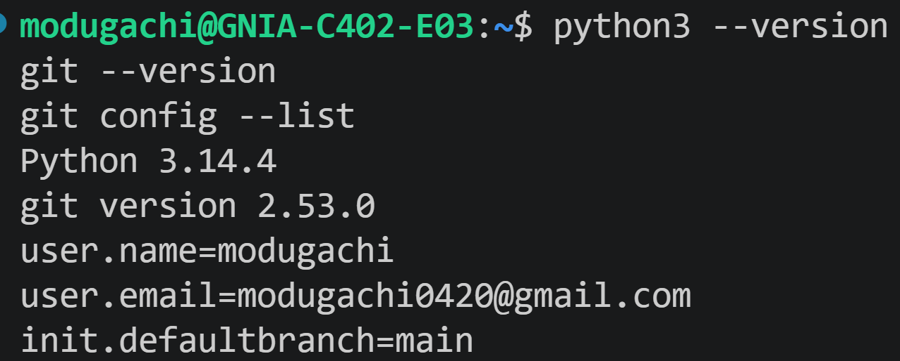

### 메뉴

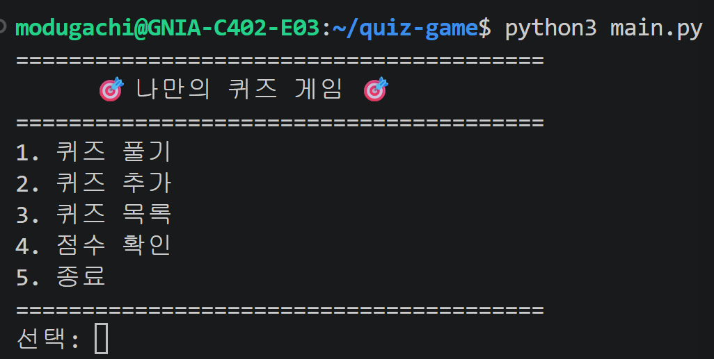

### 잘못된 입력 처리

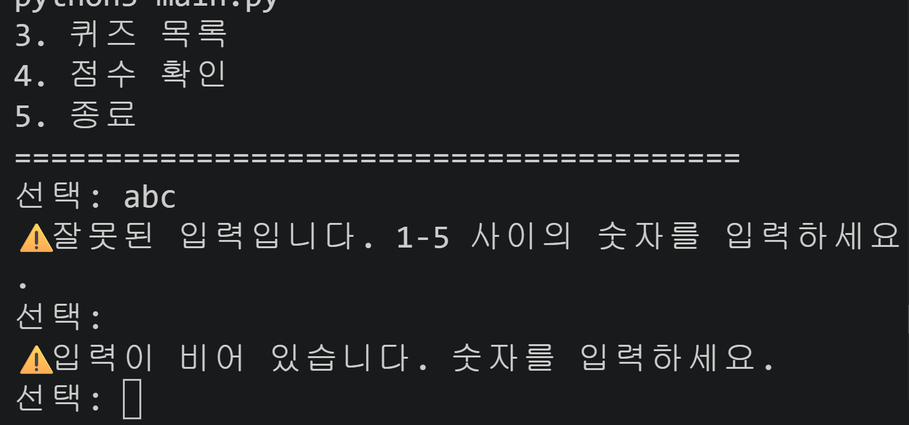

### 퀴즈 풀기와 결과(점수)

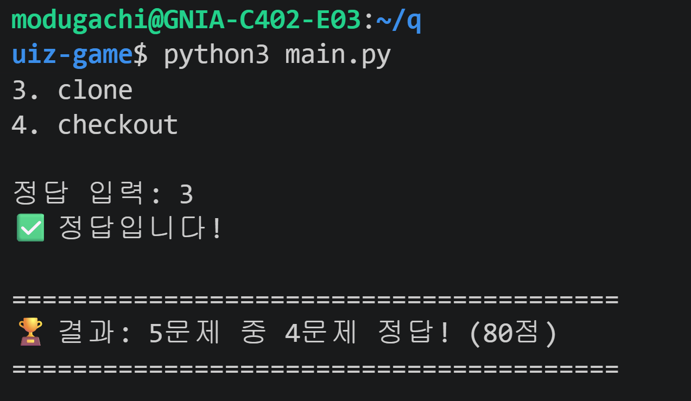

### 퀴즈 추가

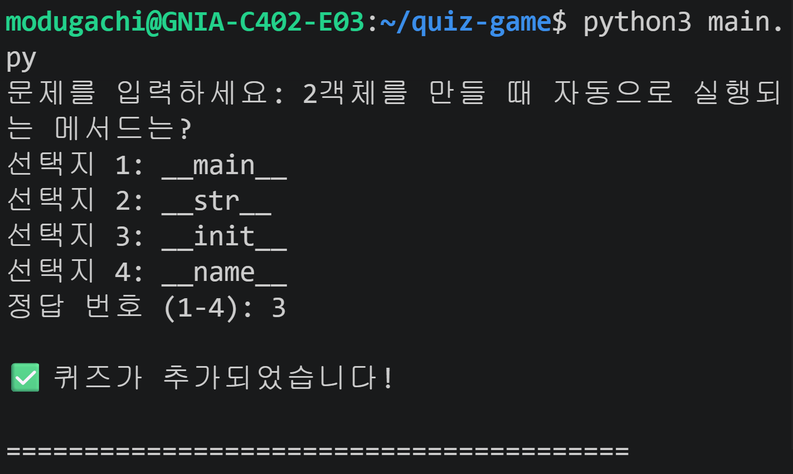

### 퀴즈 목록

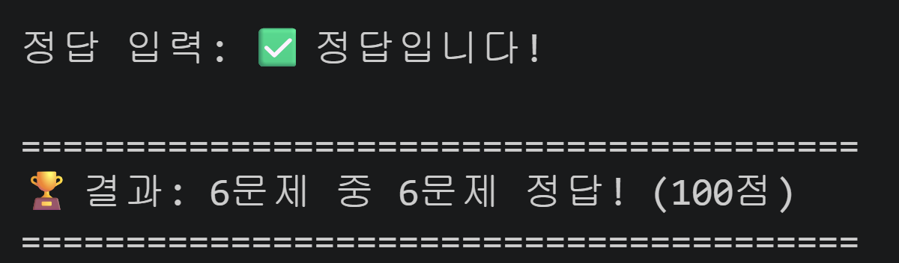

### 점수 확인

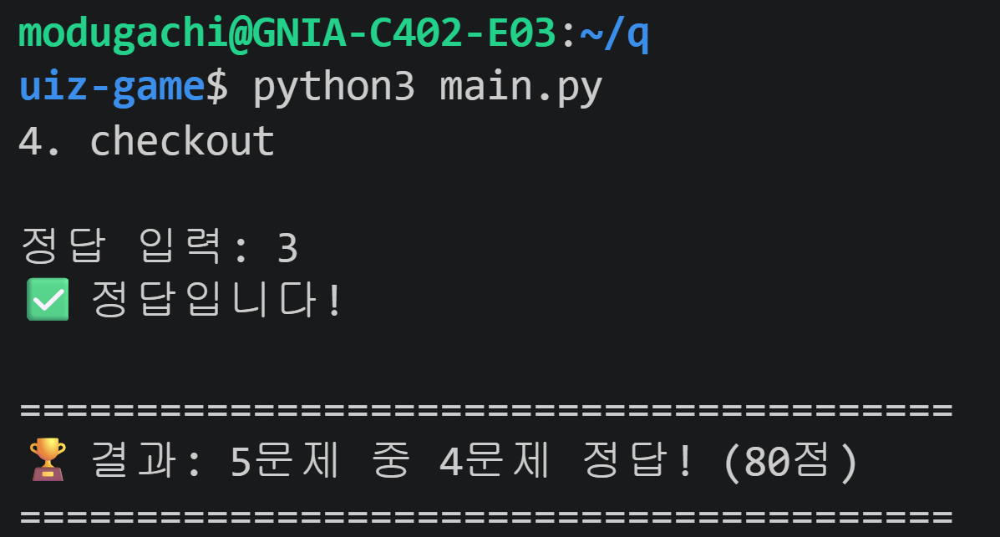

### 재시작 후 데이터 유지

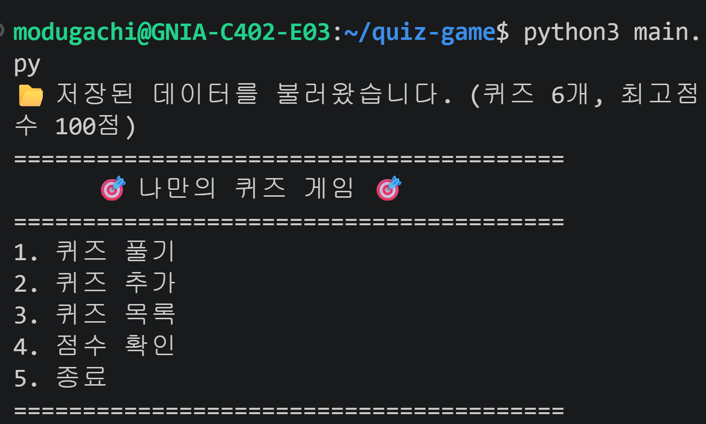

### git log --oneline --graph

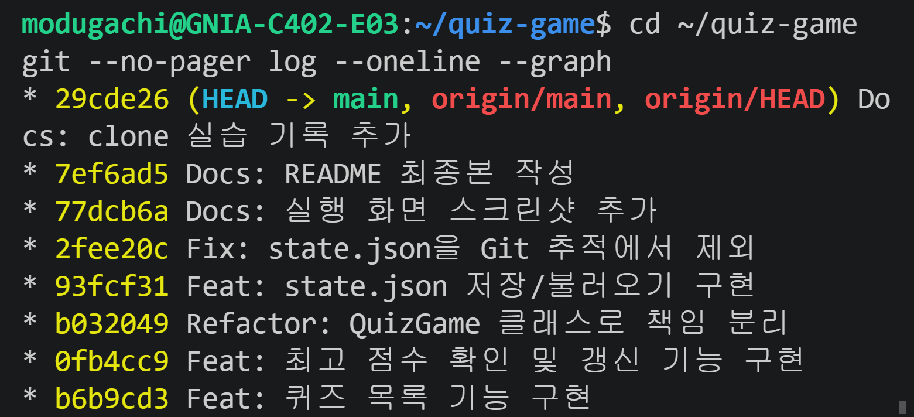

### git 명령어 사용 기록 (init 등)

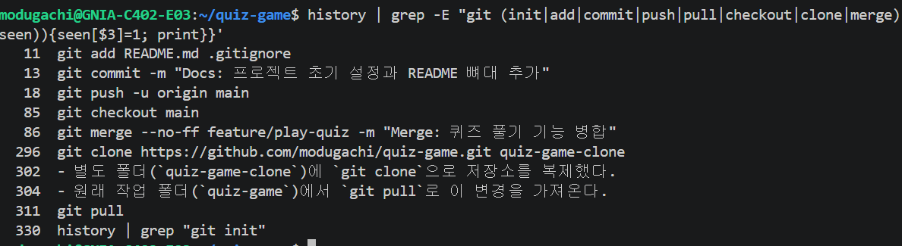

### git clone 실행

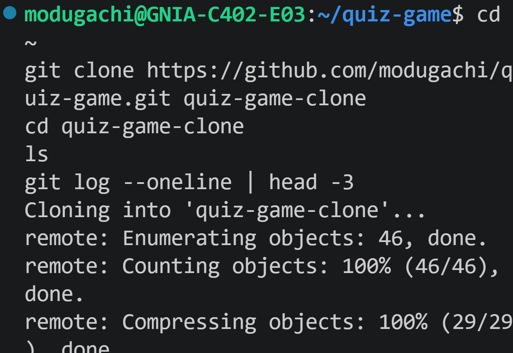

### git pull 결과

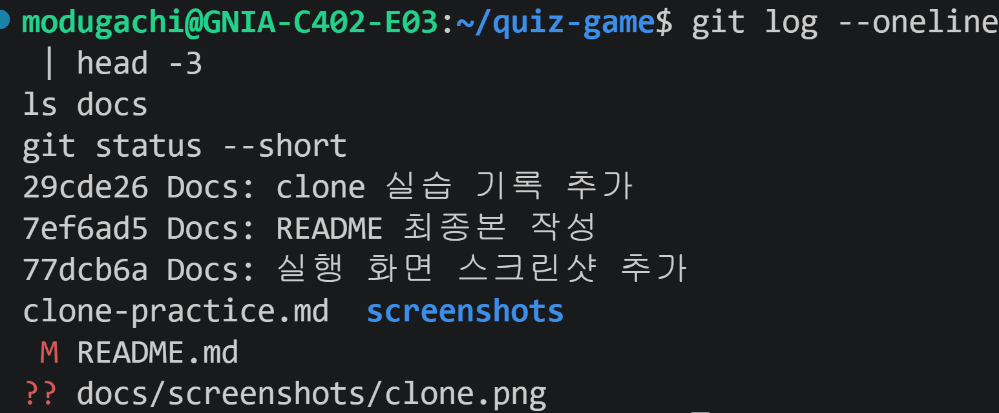

## 13. 제출물 체크리스트

- [x] GitHub 저장소 URL: `https://github.com/modugachi/quiz-game`
- [x] 개발 환경 설정 스크린샷
- [x] 프로그램 실행 결과 스크린샷 (퀴즈 추가, 목록, 플레이, 점수)
- [x] `git log --oneline --graph` 결과 스크린샷
- [x] 퀴즈 5개 이상, 클래스 2개 이상, 커밋 10개 이상
- [x] 브랜치 생성과 병합 1회 이상
- [x] Git 기초 명령어 7종(`init`, `add`, `commit`, `push`, `pull`, `checkout`, `clone`) 사용 기록
- [x] `clone`과 `pull` 각 1회 이상
- [x] README의 자리표시를 모두 실제 값으로 교체
- [x] 퀴즈 1000개 이상 성능 측정과 결과 요약 ([14장](#14-성능-분석-퀴즈-1000개-이상))
- [x] 백업 파일 생성과 복구 절차 ([15장](#15-백업과-복구-절차))
- [x] 요구 변경 시 수정 위치 정리 ([16장](#16-요구-변경-시-수정-위치))

## 14. 성능 분석 (퀴즈 1000개 이상)

### 14-1. 측정 목적과 방법

퀴즈가 많아져도 저장, 불러오기, 목록 출력이 실용적인 시간 안에 끝나는지 확인한다. 측정 프로그램은 `benchmark.py`이고, 표준 라이브러리(`time`, `tracemalloc`, `tempfile`)만 사용한다.

| 항목 | 내용 |
|---|---|
| 측정 대상 | 퀴즈 1,000개 / 5,000개 / 10,000개 |
| 측정 항목 | 저장(`save`), 불러오기(`load`), 목록 출력(`show_quiz_list`), 파일 크기, 불러올 때 최대 메모리 |
| 측정 방식 | 각 항목을 5번 반복해 **중앙값**을 사용 (한 번의 우연한 느려짐을 제외) |
| 메모리 | `tracemalloc`으로 불러오는 동안의 최대 사용량을 따로 측정 (시간 측정에는 영향 없음) |
| 안전장치 | 임시 폴더에서만 측정해서 실제 `state.json`은 건드리지 않음 |

실행 방법:

```bash
python3 benchmark.py
```

### 14-2. 측정 결과

| 퀴즈 수 | 저장 (ms) | 불러오기 (ms) | 목록 출력 (ms) | 파일 크기 (KB) | 불러올 때 최대 메모리 (MB) |
|---:|---:|---:|---:|---:|---:|
| 1,000 | 12.1 | 2.4 | 0.4 | 260 | 1.15 |
| 5,000 | 54.8 | 11.5 | 1.8 | 1303 | 5.33 |
| 10,000 | 111.8 | 24.1 | 3.6 | 2606 | 10.54 |

퀴즈 수가 10배(1,000 → 10,000개)가 될 때: 저장 9.2배, 불러오기 10.0배, 목록 출력 9.6배, 메모리 9.2배 증가

> 측정 환경: Ubuntu on WSL, Python 3.14.4. 숫자는 컴퓨터 성능에 따라 달라지지만, **퀴즈 수와 시간·메모리가 비례하는 모양**은 같다.

### 14-3. 해석

| 동작 | 시간 복잡도 | 이유 |
|---|---|---|
| 저장 | O(n) | 퀴즈 n개를 모두 딕셔너리로 바꿔(`to_dict`) 파일에 쓰고, 백업 전에 기존 파일을 한 번 검사(읽기)함 |
| 불러오기 | O(n) | 퀴즈 n개를 하나씩 읽고 형식을 검사(`from_dict`)함 |
| 목록 출력 | O(n) | `for`로 퀴즈를 하나씩 출력함 |
| 메모리 | O(n) | 모든 퀴즈를 리스트로 메모리에 올려 두므로 퀴즈 수에 비례함 |

- **결론:** 시간과 메모리 모두 퀴즈 수에 **거의 비례**(선형)해서 늘어나고, 퀴즈 1,000개 수준에서는 사람이 느낄 만한 지연이 없다.
- **병목:** 퀴즈 풀기는 문제마다 사람이 답을 입력하므로, 실제로 오래 걸리는 것은 컴퓨터의 처리가 아니라 입력 시간이다.
- **한계와 개선 방향:** 저장할 때마다 파일 **전체**를 다시 쓰므로, 퀴즈가 수십만 개 이상으로 늘어나면 변경분만 저장하는 방식(예: SQLite)을 고려한다.

## 15. 백업과 복구 절차

### 15-1. 자동 백업과 복구 동작

| 상황 | 프로그램의 동작 | 화면 문구 |
|---|---|---|
| 저장할 때 | 임시 파일에 먼저 쓰고, 기존 정상 파일을 `state.json.bak`으로 백업한 뒤 교체 | (없음) |
| `state.json`이 없음 | 기본 퀴즈 5개로 시작 | `🆕 저장된 데이터가 없어 기본 퀴즈로 시작합니다.` |
| `state.json`이 손상됨 + 백업 정상 | 손상 파일을 `state.json.corrupt`로 보관하고 **백업으로 복구** | `⚠️ 저장 파일이 손상되어 백업(state.json.bak)으로 복구했습니다.` |
| `state.json`이 손상됨 + 백업 없음/손상 | 기본 퀴즈로 초기화하고 다시 저장 | `⚠️ 저장 파일이 손상되어 기본 퀴즈로 복구했습니다.` |
| 손상된 파일이 있는 채로 저장 | 손상된 파일은 백업하지 않음 (정상 백업을 지키기 위해) | (없음) |

### 15-2. 관련 파일

| 파일 | 역할 | 생성 시점 |
|---|---|---|
| `state.json` | 현재 데이터 | 첫 저장 |
| `state.json.bak` | 직전 정상 데이터의 백업 | 두 번째 저장부터 |
| `state.json.corrupt` | 손상된 파일 보관 (원인 분석용) | 손상을 발견했을 때 |
| `state.json.tmp` | 저장 도중에만 쓰는 임시 파일 | 저장하는 동안 |

이 네 파일은 `.gitignore`의 `state.json*` 한 줄로 Git에서 제외한다.

### 15-3. 직접 복구하는 절차

프로그램이 자동으로 복구하지만, 직접 확인하거나 되돌려야 할 때는 아래 순서로 한다.

1. **프로그램을 종료한다.** (메뉴 5번)
2. **파일 상태를 확인한다.**

```bash
ls -la state.json*
```

3. **어느 파일이 정상인지 검사한다.** 오류 없이 내용이 나오면 정상이다.

```bash
python3 -m json.tool state.json.bak
```

4. **정상인 백업으로 되돌린다.**

```bash
cp state.json.bak state.json
```

5. **프로그램을 실행해 `📂 저장된 데이터를 불러왔습니다.`가 나오는지 확인한다.**

```bash
python3 main.py
```

6. **백업도 쓸 수 없으면 초기화한다.** 기본 퀴즈 5개로 새로 시작한다.

```bash
rm -f state.json state.json.bak state.json.tmp
```

### 15-4. 저장이 실패할 때

`⚠️ 저장 중 오류가 발생했습니다. 파일 권한과 디스크 공간을 확인하세요.`가 나오는 경우다. 프로그램은 종료되지 않고 계속 실행되며, 종료할 때 저장을 한 번 더 시도한다.

| 확인할 것 | 명령 | 해결 |
|---|---|---|
| 폴더에 쓰기 권한이 있는지 | `ls -ld .` | `chmod u+w .` |
| 디스크 공간이 남았는지 | `df -h .` | 불필요한 파일 삭제 |
| 파일이 읽기 전용인지 | `ls -l state.json` | `chmod u+w state.json` |

원인을 해결한 뒤 메뉴에서 퀴즈를 추가하거나 정상 종료(메뉴 5번)하면 다시 저장된다.

### 15-5. 한계

- 전원 차단이나 강제 종료(`kill -9`)처럼 프로그램이 정리할 틈이 없는 종료는 막을 수 없다. 다만 임시 파일에 쓴 뒤 교체하는 방식이라 **원본이 반쯤 쓰인 상태로 남을 가능성은 낮고**, 마지막 저장 이후의 변경만 사라진다.
- 프로그램을 **동시에 두 개** 실행해 같은 `state.json`에 저장하는 경우는 지원하지 않는다. (나중에 저장한 쪽이 덮어쓴다)
- 백업은 직전 1개만 보관한다. 여러 시점의 이력이 필요하면 Git이나 날짜별 백업을 추가해야 한다.

## 16. 요구 변경 시 수정 위치

요구가 바뀌었을 때 **어디를 고치고 무엇을 함께 확인해야 하는지** 정리했다.

| 요구 변경 | 반드시 고칠 곳 | 함께 확인할 곳 |
|---|---|---|
| 점수 계산 방식 변경 (예: 오답 감점) | `QuizGame.play_quiz`의 `score = round(...)` | `update_best_score`, `read_state`의 최고 점수 범위 검사(0~100), 7장 `best_score` 설명 |
| 선택지 개수 변경 (4개 → 5개) | `Quiz.from_dict`의 `len(choices) != 4`, `QuizGame.add_quiz`의 `range(1, 5)`와 `get_number(..., 1, 4)`, `QuizGame.play_quiz`의 `get_number("정답 입력: ", 1, 4)` | `create_default_quizzes`, 이미 저장된 `state.json`(4개짜리)이 손상으로 처리되는지 |
| 퀴즈 항목 추가 (예: 해설) | `Quiz.__init__`, `to_dict`, `from_dict`, `QuizGame.add_quiz` | `Quiz.show`, `play_quiz`, 7장 필드 구조, 기존 파일에 항목이 없을 때 기본값 처리 |
| 저장 형식 변경 (예: CSV) | `QuizGame.save`, `QuizGame.read_state`, `Quiz.to_dict`, `Quiz.from_dict` | `backup_current_file`, `recover`, `STATE_FILE` 이름, `LOAD_ERRORS` |
| 저장 위치·파일 이름 변경 | `STATE_FILE`, `BACKUP_FILE`, `CORRUPT_FILE`, `TMP_FILE` | `.gitignore`, 6~7장, 15장 |
| 메뉴 추가 | `QuizGame.show_menu`, `QuizGame.run`의 분기와 `get_number("선택: ", 1, N)`, 새 메서드 | 5장 기능 목록, 12장 스크린샷 |
| 기본 퀴즈 변경 | `create_default_quizzes` | 2장 퀴즈 표 |
| 입력 검증 규칙 변경 | `get_number`, `get_text` | 8장 표, 이 함수를 쓰는 모든 메서드 |
| 최고 점수 대신 기록 목록 저장 | `QuizGame.best_score`, `update_best_score`, `show_score`, `save`, `read_state` | 7장 필드 구조, 15장 복구 동작 |

**변경 후 확인 순서**

1. `python3 main.py`로 실행해 메뉴 → 풀기 → 추가 → 목록 → 점수를 확인한다.
2. 종료 후 다시 실행해 `📂 저장된 데이터를 불러왔습니다.`가 나오는지 확인한다.
3. `python3 benchmark.py`로 성능이 크게 나빠지지 않았는지 확인한다.
4. 기능 단위로 `Feat:` 또는 `Fix:` 커밋을 하고, README를 고쳤다면 `Docs:` 커밋을 따로 남긴다.

